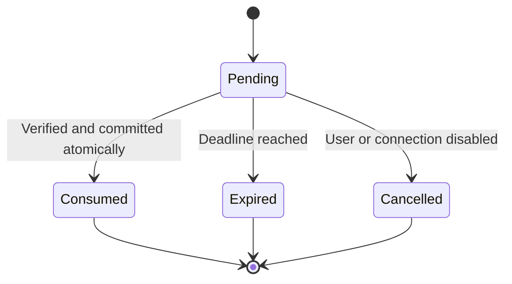
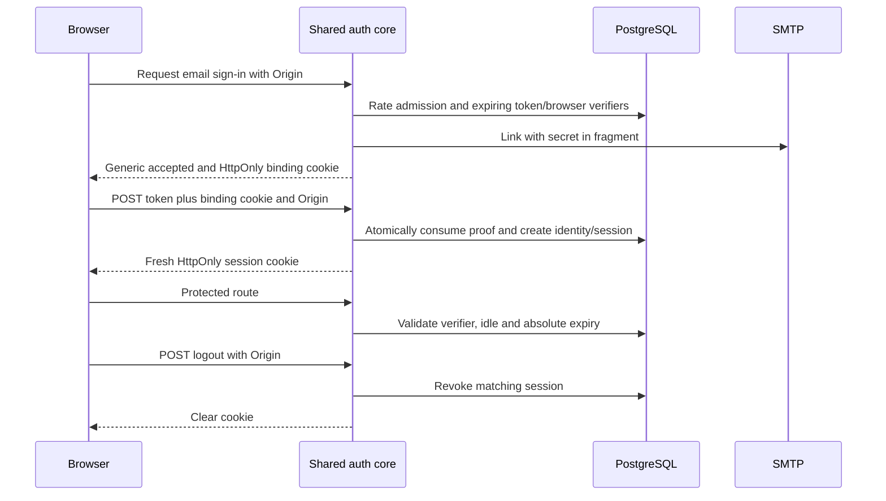
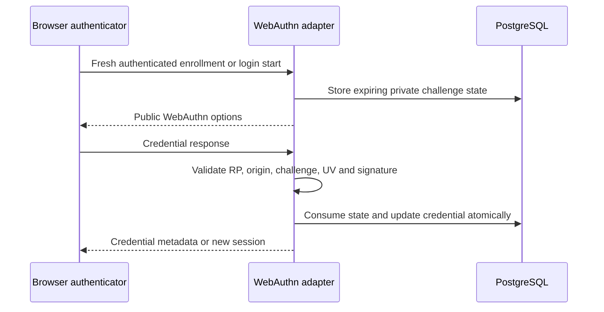
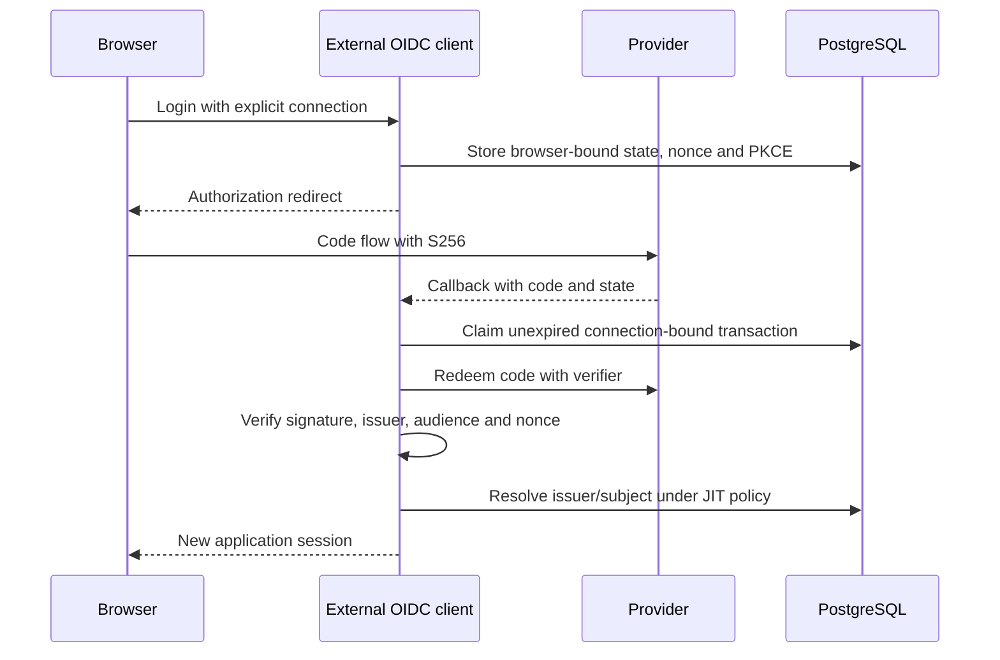
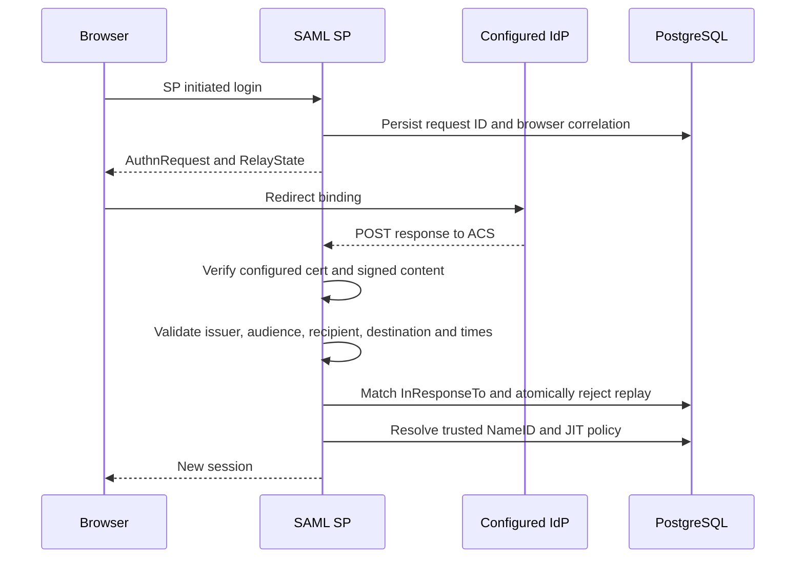

# Authentication flows

These are target designs. Only flows backed by implementation/test evidence are available. There is no generic protocol verifier abstraction.

## Transaction lifecycle


## Initial email and session flow


A GET never consumes a magic link. The email fragment is removed from history before POST; referrer policy is no-referrer. Same-browser requirement deliberately disallows cross-device email redemption initially. Mailbox compromise remains a takeover risk; email alone is not phishing resistant. Delivery occurs after proof persistence; failure leaves an expiring unusable-to-the-requester proof and allows a later fresh request under rate policy. Do not log link bodies.

## Passkeys (M03)


Embedded RP is the application's domain; centralized RP belongs to the authentication domain. Unrelated domains cannot freely share credentials. Multiple credentials, rename/removal, discoverable login, counter/backup-state updates, recovery and virtual/real authenticator tests are release requirements.

## Email-free passkey signup (AUTH-53)

The optional shared core/PostgreSQL flow below is implemented, with explicit
experimental HTTP and native anonymous platform/roaming Chromium evidence. This
does not enable ordinary server composition. Contact attachment has experimental
core/HTTP and native Chromium/SMTP evidence; full stronger-account management/
recovery remains required. See the [signup guide](../guides/passkey-signup.md).

```mermaid
sequenceDiagram
  participant browserClient as Browser authenticator
  participant authService as Shared signup core
  participant database as PostgreSQL
  browserClient->>authService: Start with display label and browser binding
  authService->>database: Bound pending state with server-selected prospective UUID
  authService-->>browserClient: Resident creation options with required UV
  browserClient->>authService: Registration response
  authService->>authService: Verify registration through high-level service
  authService->>database: Advance pending state; no user or session
  authService-->>browserClient: Account-bound assertion options
  browserClient->>authService: Signed assertion
  authService->>authService: Verify actual key proof and state snapshots
  authService->>database: Insert user/key/session/audit; final expiry and one-use consume
  authService-->>browserClient: Session secret only after atomic commit
```

## Social and external OIDC (M04/M05)

Only the optional AUTH-22 core/PostgreSQL browser-bound transaction boundary is
implemented: [guide](../guides/oauth-transactions.md),
[ADR 0013](adr/0013-oauth-state-transactions.md). It consumes state once and returns
exchange context without authenticating a user. The provider exchange, claim
verification, identity resolution and session issuance below remain target design.
Their final local transaction must recheck original deadline, enabled configuration
revision and linking authority after network exchange.



Apple uses signed client secrets and distinct native/web client identifiers; profile fields may appear only on first grant. Native code exchange binds to a backend-created nonce transaction and allowlisted audience. Private relay emails are contact attributes. Google sub is identity; email_verified is explicit claim policy. No email-based merging. Disable connections before accepting callbacks. Remote discovery/JWKS has bounded egress, DNS rebinding defense and no redirects.

## SAML SP (M06)


Cross-site POST callback binding uses a separately reviewed short-lived transaction mechanism; do not globally weaken session SameSite. No IdP-initiated SAML initially, no SLO or SAML IdP. Do not expose ACS before the SAML dependency gate passes.
