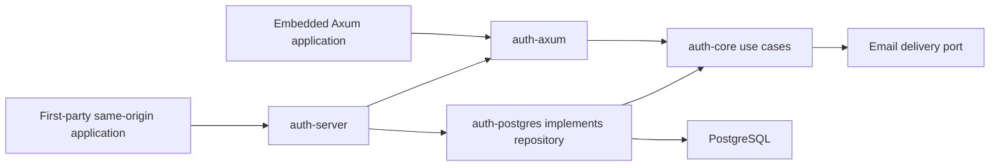

# Architecture

Project name: easy-auth (selected by the project owner). Rust stable, Tokio, Axum, SQLx/PostgreSQL. One binary and PostgreSQL; SMTP is a configurable delivery dependency. No mandatory JavaScript runtime or cache.

The first workspace has auth-core (use cases, repository/email ports and domain DTOs), auth-postgres (SQL transactions/migrations), auth-axum (HTTP/cookie boundary) and auth-server (composition/config). Protocol modules are added only as implemented; no empty protocol crates. An SDK is introduced with a real remote use case. Domain authorization remains in the consuming application.

Follow the [code organization guide](code-organization.md) for feature ownership, folder layout and maintainability review. Crate entry files expose deliberate APIs; feature implementation and tests live in focused modules within these boundaries.

Arrows into core denote compile-time dependency, not a network RPC. Runtime core calls a repository port implemented by PostgreSQL. The server never reaches into tables directly. Embedding selects a server-configured realm and origin. Standalone alpha supports only same-origin first-party browser integration; unrelated apps require the M07 issuer, not cookie sharing.

Inbound OIDC clients and SAML SPs resolve verified external identities. Outbound OIDC issuer/client registration is a distinct module and release gate; no discovery endpoint is advertised until implemented and tested. Secrets are never part of public user/session DTOs.

See domain-model, auth-flows, api-contract, deployment and the threat model. Authentication release is blocked on the six method categories, issuer interoperability and security review, even if alpha email works.

[ADR 0021](adr/0021-saml-verification-and-approval.md) records the SAML verifier
recommendation and separate implementation, test, review and independent-approval
gates. Gated integration work may progress; normal SAML activation remains closed.

The opt-in core/PostgreSQL `saml-requests` component implements trusted outgoing
registration, library-generated SP metadata/Redirect requests, hash-only browser/
RelayState persistence, one-use cancellation and response-preparation consumption
with original database timing. Preparation is not a verified identity. It uses the crypto-disabled
producer only and grants no identity/session. [Component limits](../guides/saml.md)
remain explicit. The separately gated ACS and confirmed-deletion components are
implemented below; dependency, XML/backend and independent approval gates stay open.

The separate opt-in `saml-certificates` feature adds typed operator-approved leaf
pins/windows in core and atomic revision-bound pin persistence/invalidation in
PostgreSQL. OpenSSL parses X.509/key/validity configuration; it does not verify XML.
No core policy is copied into HTTP, no new workspace crate or provider activation
is introduced, and no storage lock spans certificate parsing.

The explicit `saml-verification` core/PostgreSQL feature adds the concrete qualified
AWS-LC message adapter and fresh database configuration/clock port. Authenticated
typed facts and staged replay hashes return an opaque proof without local authority.
Final authority is supplied only by the separate opt-in identity component.
The separately gated HTTP/browser and confirmed-deletion components have bounded
owned Keycloak acceptance; broader profiles and independent approval remain gates.
Normal composition exposes no SAML ACS; no independent approval is established.

The gated `saml-identities` feature adds exact-registration default-deny policy,
opaque mapping and atomic registration/pin/policy configuration. `SamlSignIn` now
commits durable replay, exact-subject ownership, source-bound session and audit
atomically. Current-source authentication/inventory/revocation fail closed, including
backend-disabled builds. Attribute-selected mapping remains unsupported.
Purpose-bound confirmed deletion is implemented separately below; [ADR 0023](adr/0023-saml-identity-session-commit.md)
records this boundary. Normal SAML remains disabled.

`SamlDeletionRequests` adds separate deletion-purpose preparation under the same
opt-in feature. It binds an active initiating SAML owner/session/identity, requests
ForceAuthn through the established library and retains the earliest original
request/session cap. Its opaque preparation grants no authentication or erasure.
`SamlDeletionVerifier` and `SamlAccountDeletion` now compose unchanged signature
verification and the atomic source/owner/subject/freshness/replay-gated erasure
transaction. An explicit same-policy HTTP extension now supplies separate private proof
cookies and confirmation at start/finish. Eight owned Keycloak/Chromium deletion
cases pass, including retained-SSO password challenge and newer signed AuthnInstant;
ordinary old-authentication wire coverage now passes through the maintained
producer and real PostgreSQL; independent approval remains pending.
[ADR 0028](adr/0028-saml-attribute-and-authentication-facts.md) also records the
complete scalar attribute projection and unchanged NameID ownership policy.
[ADR 0025](adr/0025-saml-account-deletion.md) records this staged boundary.

The optional `oidc-egress` feature keeps URL/address/cache/metadata policy in core,
current enabled configuration checks in PostgreSQL, and the concrete `OidcHttps`
adapter in the server library. Embedded consumers share that adapter. Short registry
transactions commit before DNS/HTTPS; cached or fetched documents confer no identity
authority. No provider route is activated. [ADR 0014](adr/0014-oidc-egress.md) records
pinning, resource bounds and the native resolver limitation.

The optional `oidc-verification` feature builds on those documents and consumed
OAuth state. Core uses fixed per-key josekit/OpenSSL verification with mandatory
typed claim policy and bounded workers. PostgreSQL reuses configuration/owner/session
locks and final database time before and after I/O. Its opaque verified identity
retains original transaction/token caps and grants no local session or linking
authority. Its optional code exchange uses original S256 proof and explicit
registered client authentication through the same pinned HTTPS adapter. An owned
local Keycloak/browser/PostgreSQL suite verifies that boundary using a private
fixture certificate/address mapping and shared production request code. Final
ordinary provider activation and complete lifecycle acceptance remain open.
[ADR 0015](adr/0015-oidc-token-verification.md) records the boundary.

The explicit core/PostgreSQL `oidc-identities` features add exact-connection mapping
policy, an issuer allowlist and default-deny JIT configuration. Trusted policy
application rotates connection revision and cancels pending state atomically while
retaining disable. Mapping alone grants nothing; `OidcSignIn` consumes the mapped
proof in an atomic current-policy/JIT/subject/session/audit transaction. Provider-only
users have explicit policy and current source-bound sessions. Ordinary routes,
linking and complete provider lifecycle remain gated. Owned Keycloak acceptance now
extends through final JIT/session commit, with publication tracked separately.
[ADR 0016](adr/0016-oidc-identity-mapping.md) records that boundary.

AUTH-55's optional provider deletion use case consumes a separate purpose-bound
proof and requires the initiating source's exact subject and genuine recent signed
authentication. The shared account erasure tail supports absent verified contact;
the caller holds source/owner/session/identity locks and retains every original cap
through the final clock check. An explicit opt-in provider deletion HTTP/browser composition is implemented;
owned provider-to-HTTP acceptance is recorded and ordinary activation remains gated. [ADR 0017](adr/0017-provider-account-deletion.md)
and the [deletion guide](../guides/oidc-account-deletion.md) record that boundary.

[ADR 0018](adr/0018-oidc-web-composition.md) records AUTH-56's shared OIDC browser
composition, including a common exact callback, explicit session handling and stable
startup configuration. Stable policy loading and an opt-in Axum browser boundary
and shared standalone/embedded configuration are implemented; supported-mode
native public-login acceptance now has owned Keycloak evidence with explicit
private-transport limits. See the [verification history](../security/verification.md)
for dated checks and the [browser guide](../guides/oidc-web.md) for the opt-in
contract. Broader release gates remain open.

AUTH-23's optional core `google` component fixes Google issuer/egress/RS256/scope
and registered wire-authentication policy around the same opaque sign-in exchange.
It returns the existing verified identity proof and adds no SQL, route, native
transport or local-session grant. The [component guide](../guides/google.md) and
[ADR 0019](adr/0019-google-code-flow.md) distinguish offline signature controls from
the remaining public callback/native transport and real-provider lifecycle acceptance.

The core Google callback decoder retains bounded actual state/issuer and a redacted
untrusted outcome. Transport-independent decoding cannot consume/cancel pending
state or issue authority. Its real PostgreSQL controls preserve private-operation
binding before code exchange or cancellation; public web/native delivery remains
separate work and the generic callback contract stays unchanged.

Core `GoogleAuthorization` now shares sign-in-only start/callback completion and
operation cancellation across future web/native transports. It composes exact
existing source snapshots, preserves private database bindings and error types,
and returns the existing verified identity proof without a local grant. Transports
still need actual trusted-route/listener delivery and the reviewed lifecycle gate.

Server `google-desktop` now supplies owned, bounded literal-loopback HTTP delivery
and an opaque captured callback that feeds the same core authorization use case.
It does not own provider registration, system-browser launch, remote application
tokens or mobile delivery. Default startup and generic web composition are unchanged;
owned real listener/PostgreSQL/offline-signature acceptance now has nine server
scenarios. Registered provider, supported OS browser launch/return and lifecycle
remain gates; those components do not establish Google/native interoperability.

Core `GoogleSessionAgeCodeExchange` is an explicit eligible-client profile around
the same validated Google exchange. It requests fixed signed authentication time,
requires its actual presence and keeps sign-in and deletion proof purposes separate.
The shared Google authorization use case can select it without duplicating callback
bindings. Existing PostgreSQL deletion still owns genuine age/owner/subject/session/
source/final-cap checks and atomic erasure. Neither requested claims nor recent
token/local-session creation establishes freshness or real provider eligibility.

`GoogleAccountDeletionAuthorization` now composes deletion-purpose authorization,
callback verification and bound cancellation with that explicit profile. A private
concrete selection reuses the sign-in operation's binding implementation while
keeping the public sign-in and deletion purpose restrictions separate. It returns
proof only; PostgreSQL still owns actual deletion. Registered provider/lifecycle
acceptance remains a gate for ordinary activation.

Axum's opt-in `google-web` feature now composes those services with HTTPS-only
same-origin sign-in/deletion routes, separate protected proof cookies and fixed
Google callback/reference pages. Google-specific parsing stays in core; GET only
selects fixed UI and POST delegates verification/mapping/commit. The original
anonymous-session guard and explicit revocation-cookie hygiene are shared with OIDC.
Generic OIDC contracts and ordinary server startup remain unchanged. Owned HTTPS/
PostgreSQL/offline-signature evidence is distinct from registered Google, supported
OS browser delivery and usable genuine-freshness/lifecycle acceptance.

The optional server `google-desktop-launch` feature adds a single owned native
sign-in operation: private transient proof, first OS opener command, concurrent
bounded callback capture, child cleanup and shared core verification. Local grant
still requires existing mapping/commit. It adds no remote tokens or ordinary startup
activation. Source reconfiguration invalidates earlier source sessions; actual OS/
registered Google and reviewed native lifecycle acceptance remain open.

[ADR0020](adr/0020-native-oauth-operation-returns.md) separates an explicit stable
desktop registration from each exact owned loopback return. Core owns profile and
operation binding, PostgreSQL persists profile/return under existing locks and
original final caps, and Google/native composition uses the retained actual URI.
Reopened/concurrent ports preserve source sessions; real administrative revision
changes and disable remain authoritative. Exact HTTPS/native defaults and ordinary
startup stay unchanged. Actual provider/OS and broader native lifecycle remain gates.

The registered Google native acceptance example is developer-only composition of
the same stable operation, protected input reader and core/PG final commit. It
separates local input/public owned-setup checks from actual browser sign-in, and
revokes/removes only disposable local authority. No application startup/API or
proof-construction boundary changes. Real provider/OS and lifecycle gates remain.

The explicit Axum `saml-web` feature now supplies gated reference sign-in/metadata,
non-authoritative cross-site POST delivery and same-origin final completion over
those existing core/PG services. It preserves Lax cookies and detects existing
sessions at same-origin finish. Normal router/server startup stays unchanged.
[ADR 0024](adr/0024-saml-web-delivery.md) separates ordinary HTTP/browser evidence
from deployed IdP interoperability and mandatory independent approval.

Owned Keycloak26.8.1 acceptance now exercises the same gated SAML HTTP/core/PG
composition with ten actual provider cases: persistent identity, explicit JIT,
provider-managed certificate overlap/retirement, equal-subject tenant isolation
and disable. No production implementation or cryptographic policy was changed.
The [provider guide](../guides/saml-providers.md) scopes that evidence and records
Entra's documented lifetime incompatibility and untested Okta requirements.
Broader actual IdP qualified/attribute profiles and independent approval remain
open. The ordinary older-authentication component wire gap is now covered by
ADR 0028; this does not establish that profile for every actual IdP. The separate confirmed-deletion suite covers
eight owned Keycloak cases; see [ADR 0025](adr/0025-saml-account-deletion.md).

The optional `issuer-clients` core/PostgreSQL component now separates trusted
outbound HTTPS web-client registration and opaque hostname-sector subjects from
inbound federation. It adds no HTTP/issuer startup route, authentication grant or
user-consent completion. [ADR0026](adr/0026-outbound-client-registration.md) records
exact redirects, fixed explicit-consent policy and stored random subject decisions.
M07 and AUTH-32 release prerequisites remain open; this is gated engineering only.

Normal server SAML configuration and single/combined OIDC/SAML route selection are
prepared under [ADR 0029](adr/0029-gated-saml-server-composition.md). The source
activation check remains closed before database loading, and disabled normal
startup mounts no SAML routes. Trusted startup loading is read-only and cannot
re-enable or reconfigure an existing provider. Security approval remains separate.
