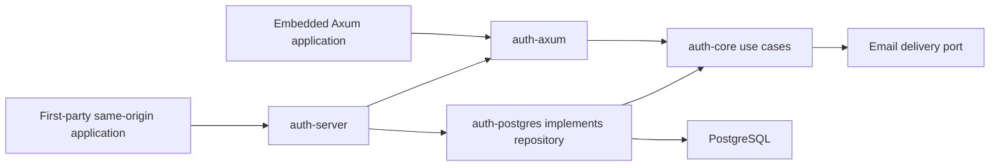

# Architecture

Project name: easy-auth (selected by the project owner). Rust stable, Tokio, Axum, SQLx/PostgreSQL. One binary and PostgreSQL; SMTP is a configurable delivery dependency. No mandatory JavaScript runtime or cache.

The first workspace has auth-core (use cases, repository/email ports and domain DTOs), auth-postgres (SQL transactions/migrations), auth-axum (HTTP/cookie boundary) and auth-server (composition/config). Protocol modules are added only as implemented; no empty protocol crates. An SDK is introduced with a real remote use case. Domain authorization remains in the consuming application.

Arrows into core denote compile-time dependency, not a network RPC. Runtime core calls a repository port implemented by PostgreSQL. The server never reaches into tables directly. Embedding selects a server-configured realm and origin. Standalone alpha supports only same-origin first-party browser integration; unrelated apps require the M07 issuer, not cookie sharing.

Inbound OIDC clients and SAML SPs resolve verified external identities. Outbound OIDC issuer/client registration is a distinct module and release gate; no discovery endpoint is advertised until implemented and tested. Secrets are never part of public user/session DTOs.

See domain-model, auth-flows, api-contract, deployment and the threat model. Authentication release is blocked on the six method categories, issuer interoperability and security review, even if alpha email works.
