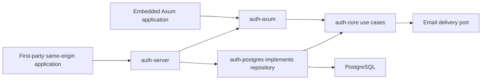

# Architecture

Project name: easy-auth (selected by the project owner). Rust stable, Tokio, Axum, SQLx/PostgreSQL. One binary and PostgreSQL; SMTP is a configurable delivery dependency. No mandatory JavaScript runtime or cache.

The first workspace has auth-core (use cases, repository/email ports and domain DTOs), auth-postgres (SQL transactions/migrations), auth-axum (HTTP/cookie boundary) and auth-server (composition/config). Protocol modules are added only as implemented; no empty protocol crates. An SDK is introduced with a real remote use case. Domain authorization remains in the consuming application.

Follow the [code organization guide](code-organization.md) for feature ownership, folder layout and maintainability review. Crate entry files expose deliberate APIs; feature implementation and tests live in focused modules within these boundaries.

Arrows into core denote compile-time dependency, not a network RPC. Runtime core calls a repository port implemented by PostgreSQL. The server never reaches into tables directly. Embedding selects a server-configured realm and origin. Standalone alpha supports only same-origin first-party browser integration; unrelated apps require the M07 issuer, not cookie sharing.

Inbound OIDC clients and SAML SPs resolve verified external identities. Outbound OIDC issuer/client registration is a distinct module and release gate; no discovery endpoint is advertised until implemented and tested. Secrets are never part of public user/session DTOs.

See domain-model, auth-flows, api-contract, deployment and the threat model. Authentication release is blocked on the six method categories, issuer interoperability and security review, even if alpha email works.

The optional `oidc-egress` feature keeps URL/address/cache/metadata policy in core,
current enabled configuration checks in PostgreSQL, and the concrete `OidcHttps`
adapter in the server library. Embedded consumers share that adapter. Short registry
transactions commit before DNS/HTTPS; cached or fetched documents confer no identity
authority. No provider route is activated. [ADR 0014](adr/0014-oidc-egress.md) records
pinning, resource bounds and the native resolver limitation.

The optional `oidc-verification` feature builds on those documents and consumed
OAuth state. Core uses fixed per-key josekit/OpenSSL verification with mandatory
typed claim policy and bounded workers. PostgreSQL reuses configuration/owner/session
locks and final database time before and after I/O. Its opaque verified identity
retains original transaction/token caps and grants no local session or linking
authority. Its optional code exchange uses original S256 proof and explicit
registered client authentication through the same pinned HTTPS adapter. An owned
local Keycloak/browser/PostgreSQL suite verifies that boundary using a private
fixture certificate/address mapping and shared production request code. Final
identity mapping/JIT/session issuance and ordinary provider activation remain open.
[ADR 0015](adr/0015-oidc-token-verification.md) records the boundary.
